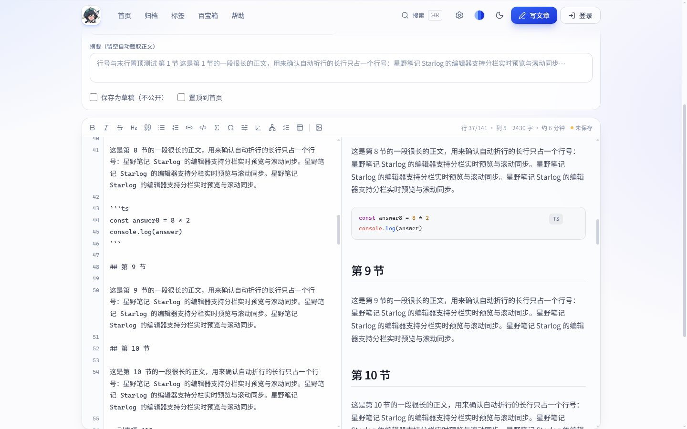
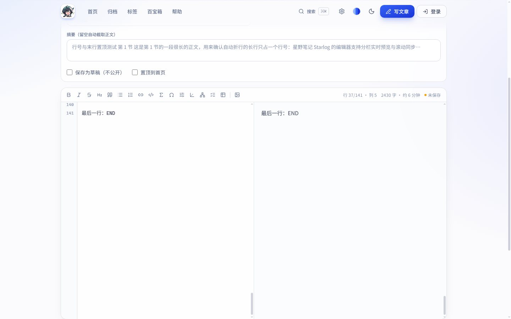

# 2026-11-17 · issue #126 – #130 —— 测试结果

对应改动：`ChangeLog.md` 的「2026-11-17 · 固定背景图片、编辑区行号与末行置顶、页面跳转不再偏移并提速、设置自动同步到账号」。

| issue | 要求 | 结果 |
| --- | --- | --- |
| #126 | 背景可切换为固定背景：`/user_upload/background_image` 下的任意图片，或本地图片 | 已实现并通过检查，见 [background-image.md](background-image.md) |
| #127 | 编辑区显示行数；编辑区可一直下滑到最后一行位于最上方 | 已实现并通过检查，见 [editor.md](editor.md) |
| #128 | 「标签」「百宝箱」与其它页面互相跳转时整页左右偏移；优化加载速度 | 位移已消除，见 [layout-shift.md](layout-shift.md)；加载与跳转见 [loading-and-navigation.md](loading-and-navigation.md) |
| #129 | 所有设置自动保存到对应的 GitHub 账号 | 已实现并通过检查，见 [settings-sync-e2e.md](settings-sync-e2e.md) |
| #130 | 用户设置不保存到仓库，基于 GitHub Discussions 保存 | 同上；仓库写入路径已全部移除 |

## 结论

| 检查项 | 结果 |
| --- | --- |
| `npm run build`（`tsc --noEmit` + `vite build`） | 通过 |
| `npm test` · Web 特性测试（`scripts/test-features.mjs`） | 17 组全部通过（原有 13 组 + 新增 4 组） |
| `npm test` · VS Code 插件回归（`npm run extension:test`） | 77 项：73 通过、0 失败、4 项真实浏览器测试按默认跳过 |
| 插件真实 Chromium 对照（`npm --prefix vscode_extensions/v1 run test:browser`） | 4 项全部通过 |
| `npm --prefix vscode_extensions/v1 run typecheck` | 通过 |
| `npm run build:offline`（含 `scripts/verify-offline.mjs`） | 通过：21.56 MB、16 篇内置文章、未出现在线端点；已同步 `offline/index.html` |
| 新增用例的变异检查 | 11 种「改坏」的写法全部被拦住 |
| 真实 Chromium · 页面跳转位移（#128） | 改动前页头在 91 ↔ 96px 之间位移；改动后各页面完全一致 |
| 真实 Chromium · 加载与跳转（#128） | 慢速 4G：点开文章 1958 → 139 ms，页签切换约 220 → 60–87 ms，首页 LCP 1704 → 1628 ms |
| 真实 Chromium · 编辑器（#127） | 行号与正文逐行对齐；滚到底时最后一行距编辑区顶部 19px；页面报错 0 个 |
| 真实 Chromium · 固定背景图片（#126） | 仓库图片 / 本地图片 / 遮罩与模糊 / 刷新后保留 / 先后关系全部符合预期 |
| 真实 Chromium · 设置同步（#129 / #130） | 20 项检查全部通过；全程 REST 只有 `GET /user`，没有任何仓库写入 |
| 真实 Chromium · 其它行为与离线单文件版 | 12 项检查全部通过，见 [other-checks.md](other-checks.md) |

## 各项说明

### #128 页面跳转位移

原因是滚动条：「标签」「百宝箱」一屏放得下、没有滚动条，其它页面有，视口宽度相差 10px，居中的页头与正文相差 5px。
改动后始终为滚动条预留位置，页头的 Logo、导航、右侧按钮在所有页面上的水平位置完全相同。
回声洞（独占全屏）不预留；离开回声洞后恢复。打开搜索（锁定页面滚动）时页头也不再位移。

### #128 加载速度

- 首页冷缓存 JS 传输 212.4 KB → 199.1 KB；主包拆成 `index`（103.0 KB）+ 可长期缓存的 `vendor`（96.0 KB），
  发布文章后回访只需重新下载前者。
- 「归档」「标签」「百宝箱」并入主包：改动前每次点击要多发 1–3 个请求，改动后 0 个。
- 首屏空闲后预取文章页与 Markdown 渲染包（13 个请求、约 307 KB，在后台进行）：点开文章时代码已经到了。

### #127 编辑器

- 141 行测试稿（24 行自动折行）：行号栏每个逻辑行一个行号，折行的长段落只在第一行显示行号（截图 `editor-line-numbers.jpg`）。
- 滚到最底：最后一行距编辑区顶部 19px（顶部留白 20px），预览区最后一个内容块同时到顶（截图 `editor-last-line-on-top.jpg`）。
- 文末输入、连续回车、退格时光标所在行始终在可视区内，整页不被带着滚动；镜像层内容始终与正文一致。
- 仅编辑视图、全屏、390px 手机宽度（截图 `editor-mobile.jpg`）、关闭两个开关的情形都检查过。
- 长文按键耗时：1000 行文稿输入字符 19.8 → 22.4 ms、回车 21.1 → 25.1 ms；300 行 7.0 → 7.7 ms、6.0 → 9.0 ms。

### #126 固定背景图片

- 设置页列出 `user_upload/background_image/` 里的图片（当前 1 张：Venti1）与「选择本地图片」（截图 `background-settings.jpg`）。
- 选中后背景图层铺满视口、`position: fixed`，页面下滚 600px 后图片位置不变；遮罩用当前主题的页面底色
  （浅色 `rgb(251, 251, 253)`、深色 `rgb(13, 16, 23)`），截图 `background-home-light.jpg` / `background-home-dark.jpg`。
- 本地图片：4000×2794 的原图保存前缩小为 2880×2012（770 KB），存进 IndexedDB，刷新后仍然显示；移除后回到默认背景。
- 同时选了动态背景时图片优先（不创建动态背景画布）；文章 `::set-background[3]` 生效期间图片让位，离开文章即恢复。

### #129 / #130 设置同步

用内存里的「假 GitHub」应答接口，站点用的是真实的生产构建；两台设备是两个互相隔离的浏览器上下文。

- 登录但没改设置时不创建任何内容；改了配色、字号、行号开关、背景图片后约 1.5 秒自动保存——
  首次保存创建「设置同步」讨论（建在 General 分类）并发表一条本人的评论。
- 另一台设备登录同一账号，打开首页即恢复全部设置（截图 `settings-sync-second-device.jpg`），且不重复写入。
- 两台设备各改一项（明暗模式 / 字号），账号里两项都保留，互不覆盖。
- 选用本地背景图片：账号里只有 `source: local`，文件名不上传；另一台设备提示重新选择。
- 另一个账号各存各的；GitHub 出错时显示「同步失败」，恢复后补上；退出登录、未登录的访客都不请求 GitHub。
- 设置页的状态卡片见截图 `settings-sync-status.jpg`。

对**真实的** GitHub 只做了只读核对：用 GraphQL 内省确认了 `addDiscussionComment`、`updateDiscussionComment`、
`createDiscussion` 的输入字段和 `DiscussionComment.viewerDidAuthor`，并对本仓库执行了同步用到的只读查询
（按编号读取评论、列出讨论与评论、编号不存在时的错误形态）。没有在真实的 Discussions 里创建或修改任何内容。

## 截图

| 文件 | 内容 |
| --- | --- |
| [editor-line-numbers.jpg](editor-line-numbers.jpg) | 编辑区行号栏、工具栏右侧的「行 37/141 · 列 5」，双栏对齐 |
| [editor-last-line-on-top.jpg](editor-last-line-on-top.jpg) | 滚到底：最后一行位于编辑区最上方，预览区同步到文末 |
| [editor-mobile.jpg](editor-mobile.jpg) | 390px 手机宽度下的行号栏 |
| [background-settings.jpg](background-settings.jpg) | 设置页「固定背景图片」 |
| [background-home-light.jpg](background-home-light.jpg) / [background-home-dark.jpg](background-home-dark.jpg) | 首页使用仓库背景图，浅色 / 深色 |
| [settings-sync-status.jpg](settings-sync-status.jpg) | 设置页「设置同步」状态卡片 |
| [settings-sync-second-device.jpg](settings-sync-second-device.jpg) | 第二台设备登录后自动恢复配色、字号与背景 |

> 说明：测试沙箱里没有中文字体，截图时临时注入了 Noto Sans SC 与 Cascadia Code，只影响字形观感，不影响布局结论；
> 实际站点仍按访客设备上的字体栈显示。

## 环境与局限

- Node v22.22.3、npm 10.9.8，Debian 12（x86_64）；Chromium 153.0.8010.0（headless），由 `playwright-core` 驱动。
  浏览器、测量脚本与静态服务器都是临时文件，没有加入仓库依赖。
- **只在 Chromium 上实测。** 「末行置顶」依赖 textarea 的底部内边距计入可滚动范围：Chromium / WebKit 一直如此；
  Firefox 对应的 WPT 用例 `css-overflow/scrollable-overflow-textarea.html` 在其代码库里标记为通过，但没有在这里实跑。
- 设置同步的写入操作（创建讨论、发表 / 更新评论）只在假 GitHub 上验证过；合并上线后第一次真实同步时会在仓库的
  Discussions 里创建「设置同步」讨论。
- 字体预热的检查用脚本拦截了云端字体请求（沙箱不能访问该地址），确认的是「打开页面时会发起请求」。
